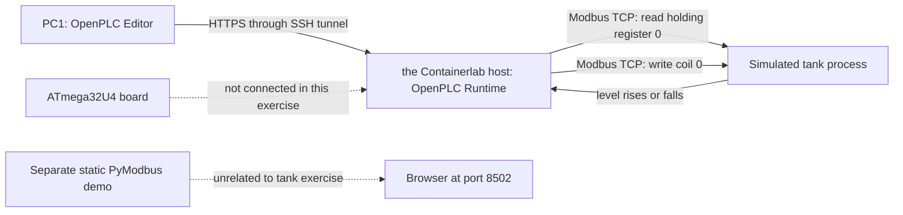

# Start here: PLC and tank simulation

This guide separates software simulation from physical hardware and walks
through one PLC control loop. You do not need an Arduino for this exercise.

## What is real, and what is simulated?

| Part | What it is | What you use it for |
| --- | --- | --- |
| OpenPLC Editor on PC1 | Desktop engineering software | Write and debug the PLC program |
| OpenPLC Runtime on the Containerlab host | A software PLC in a container | Run the IEC 61131-3 program |
| Tank process in a container | A Python process model | Change tank level in response to the pump command |
| Modbus TCP | Real protocol packets on a private container network | Carry level and pump values between PLC and tank |
| Arduino ATmega32U4 board | Physical microcontroller hardware | Optional later exercise with real pins, a button, and an LED |

The PLC, tank, sensor, and pump in this exercise are simulated. Modbus packets
are real network traffic, but they do not control physical equipment. The
Arduino is not connected to this lab.

| Term | Meaning here |
| --- | --- |
| PLC | OpenPLC Runtime, which runs the control program repeatedly |
| Scan | One pass through the program logic; this project uses a 100 ms cyclic task |
| Process | The tank model that changes level and responds to the pump output |
| Input | The measured tank level read by the PLC |
| Output | The pump command written by the PLC |



## 1. Open the Editor connection

On PC1, install and open the [OpenPLC Editor desktop app](https://github.com/Autonomy-Logic/openplc-editor/releases).
Open a terminal and keep this SSH tunnel running:

```bash
ssh -L 8443:127.0.0.1:8443 user@containerlab-host
```

In the Editor, add or select a Runtime v4 device at `127.0.0.1`, port `8443`,
with HTTPS enabled, then connect. Create the first runtime user when
prompted. This account belongs to the runtime on the Containerlab host. Save the project on
PC1; the runtime loses its copy when the lab is destroyed.

The PyModbus web page on port `8502` is a separate demo. It displays fixed
sample values. It does not show the tank, run PLC logic, or show the PLC
debugger. You can leave it closed during this exercise.

## 2. Connect the PLC to the tank model

In the project tree, add a Modbus remote device. Set:

- Transport: TCP/IP
- IP address: `172.100.120.10`
- Port: `5020`
- Unit ID: `1`

Add two I/O groups. For each group, set its function code, offset, and length
as shown. Expand the group, then set the point's Alias field:

| Alias | Function code | Offset | Length | Meaning |
| --- | --- | ---: | ---: | --- |
| `TankLevel` | Read Holding Registers (FC 3) | 0 | 1 | Tank level from 0 to 100 |
| `PumpCommand` | Write Single Coil (FC 5) | 0 | 1 | `TRUE` starts the simulated pump |

Use a cycle time of `250 ms` for each group. Leave the unit ID at `1`.
The register point uses type `UINT`; the coil point uses type `BOOL`.

The PLC is the Modbus client (master). The tank is the Modbus server (slave).
See the [OpenPLC Modbus remote-device guide](https://edge.autonomylogic.com/docs/openplc-editor/communication/modbus/client/)
for the Editor mapping screens.

## 3. Add the control logic

Create a Program POU named `TankControl` in Structured Text. In its variable
table, add:

- `TankLevel`, class `Local`, type `UINT`.
- `PumpCommand`, class `Local`, type `BOOL`.

Use the exact same spelling as the point aliases in the table above. Each
alias binds a program variable to its Modbus point and I/O location. Enter
the logic in the program editor below the variable table:

```iecst
IF TankLevel >= 80 THEN
    PumpCommand := FALSE;
ELSIF TankLevel <= 20 THEN
    PumpCommand := TRUE;
END_IF;
```

Before you build, open `Resource` in the project tree. Confirm that a cyclic
task runs an instance of `TankControl`. If the project has no task or
instance, add `MainTask` with a `T#100ms` cyclic interval, then add
`TankControlInstance` to that task and select `TankControl` as its program.
The task tells the PLC when to execute the program.

Build and upload the program, then start it. Open the Editor debug view and
watch `TankLevel` and `PumpCommand`.

The tank starts at level 25. It drains by one point every 250 ms while the
pump is off. If the program is not running, the tank drains to zero. When the
program is running, the PLC turns the pump on at or below 20. The tank then
fills. At level 80, the PLC turns the pump off and the tank drains again.

## 4. Follow the control loop

1. The PLC reads `TankLevel` from holding register 0.
2. The program compares the value with the low and high limits.
3. The PLC writes `PumpCommand` to coil 0.
4. The tank model changes the level based on the coil.
5. The next Modbus read reports the changed level.

The code uses **hysteresis**. It turns the pump on at or below 20 and off at
or above 80. Between 20 and 80 it keeps the last command. This prevents rapid
switching around one threshold.

There are three separate rates in this simulation: the PLC scans the logic
every 100 ms, the Modbus groups poll every 250 ms, and the tank changes level
every 250 ms. The PLC can run several scans between sensor updates. That is
normal; the next scan uses the latest value the Modbus master has received.

Try changing the limits to 30 and 70. Use the debugger to observe when the
pump changes state. You can also capture Modbus/TCP traffic as described in
the [lab README](README.md).

## If it does not work

- If the Editor cannot connect, keep the SSH tunnel open and connect to
  `127.0.0.1:8443` with HTTPS. This is an Editor connection, not a web page.
- If the PLC logs show Modbus errors, check the remote device uses
  `172.100.120.10:5020`. That address is reached by the PLC container; PC1
  cannot reach it directly.
- If values do not change, check that the PLC is connected, the program is
  uploaded and running, and `TankControl` is assigned to a cyclic task.

## What is not part of this exercise

- The sample PyModbus simulator and its browser page are independent test
  tools. Their static registers are not the tank process.
- The ATmega32U4 board is not used here. If the board is a Leonardo, the
  desktop Editor lists a direct USB target. A Pro Micro or clone may need a
  different board definition and pin map. Confirm the exact model before
  selecting pins. Do not connect 24 V industrial signals to Arduino pins.
- The tank, pump, level signal, and control loop are not suitable for
  controlling real equipment.

Destroying and recreating the lab removes the runtime user and project. Save
your Editor project on PC1 so you can upload it again later.
